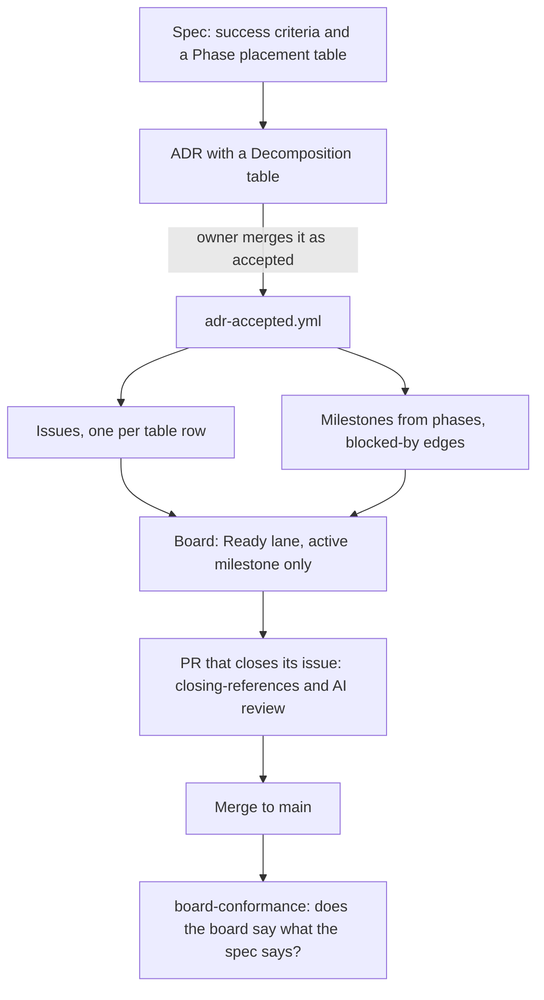

# RunGate

A ship harness for AI-first development: from issue to merged PR, with a report you can trust.

You should be able to trust that report without checking it again by hand. Coding agents can write a lot of code quickly. The hard part is believing what they say about it. "Tests pass", "0 regressions" and "security: clean" are only useful if the thing reporting them could have said something else. RunGate is built around that. The automation isn't really the product. The product is a report you don't have to re-measure.

> **Status: active development, pre-1.0.** Published on npm as [`rungate`](https://www.npmjs.com/package/rungate). It is used daily on this repo and is being proven on a second, unrelated project. Expect breaking changes between minor versions.

## What it does

RunGate sits between an issue tracker and a coding agent (Claude Code today; the design is agent-agnostic) and runs every change through a fixed pipeline:

```
issue → SCOPE → BUILD → VERIFY → CLOSE → SHIP_PASSED | SHIP_FAILED
```

- **Gates, not guidelines.** Each phase ends at a gate: typecheck, tests, test-first sequencing, security review, compliance grade, review currency, and commit receipt. A failed gate stops the ship. It is not just written into a log.
- **Specs with checkable criteria.** Work is driven by specs whose success criteria name the evidence that proves them. A criterion ticked without evidence is refused.
- **Spec → board, automatically.** A spec's phases become milestones, issues and `blocked by` edges on the GitHub project board. Nobody has to place the plan there by hand. See [From spec to merged PR](#from-spec-to-merged-pr).
- **Project-specific agent rules.** `scaffold` gives a repo its agent files and a conformity suite. `extract-constraints` mines the repo's own docs and history for rules an agent couldn't work out from the code.
- **AI review that blocks.** AI code-review findings are judged and posted as review threads on the PR diff, and a blocking finding fails the check.
- **Workflows** for `ship`, `prove` (reproduce and attest a fix), `verify`, `batch-ship`, `ship-and-heal` and multi-agent `council` decisions.

## From spec to merged PR

This is how work moves in this repository. The ten rules behind it are in [`AGENTS.md`](AGENTS.md); the engine is governed by [`specs/SPEC-TO-BOARD-PIPELINE-SPEC.md`](specs/SPEC-TO-BOARD-PIPELINE-SPEC.md) and the board lanes by [`specs/BOARD-FLOW-SPEC.md`](specs/BOARD-FLOW-SPEC.md).



### A spec says what must be true

A spec in `specs/` lists success criteria (`- [ ] SC-<N>: …`), each naming the evidence that would prove it. **A spec is never the to-do list** (rule 1): its checkboxes record what has been proved, and the work itself comes off the issue tracker. A ticked criterion must carry a `proved-by:` line naming the test that ran; `rungate audit-spec-evidence` refuses one that does not.

### Work bigger than one issue is an ADR

Small, agreed work is filed as one issue straight away. The issue names the files it will change, and there are fewer than ten (rules 2 and 3).

Anything bigger than one issue, or any change to a rule or a gate, is an ADR copied from [`docs/adr/TEMPLATE.md`](docs/adr/TEMPLATE.md) (rule 9). Its **Decomposition table** has one row per issue: the criterion it serves, the outcome (which becomes the issue title), the files, the milestone, and what blocks it. The criteria are written into the governing spec first. The `/dry-run` command (`.claude/commands/dry-run.md`) shows what the planning tools would do, without writing anything, until the repo owner agrees.

When the owner merges the ADR with `status: accepted`, [`.github/workflows/adr-accepted.yml`](.github/workflows/adr-accepted.yml) places the plan with no command typed by hand: `plan-spec`, then `plan-issues --decompose` (one issue per row), then `plan-deps`, `board-mirror` and a Ready top-up.

### Phases become milestones, and order becomes edges

A planned spec carries a **Phase placement** table that puts every criterion in exactly one phase.

- `rungate plan-spec` turns the phases into GitHub milestones (here, `Pipeline Phase 0` to `Pipeline Phase 9`).
- `rungate plan-deps` writes the phase order onto the tracker as GitHub `blocked by` edges. "What's next" is then everything unblocked, worked out by GitHub instead of read from a sentence (rule 4).

Both only report unless you pass `--write`.

### The board is a Kanban

The GitHub Project board has six lanes, and every move is triggered by a GitHub event, not by a person dragging a card:

| Lane | An issue enters when | Moved by |
|---|---|---|
| Backlog | it is filed or reopened, or anything moves backwards | `board-intake.yml`, `board-flow.yml` |
| Ready | it is unblocked, unassigned, in the active milestone, and Ready has room | `board-ready.yml` |
| In progress | someone is assigned to it | `board-flow.yml`, `board-sweep.yml` |
| In review | a linked PR is ready for review (not a draft) | `board-flow.yml` |
| Done | it is closed as completed | `board-flow.yml` |
| Cancelled | it is closed as not planned, or as a duplicate | `board-flow.yml` |

**Ready is filled only from the active milestone**: the lowest Pipeline phase that still has an open issue (`activeMilestone` in `lib/board-ready-rule.ts`). Only issues with no open blocker enter, oldest first, and Ready's size is set from recent throughput. Three more rules:

- An issue labelled `work-this-next` (the expedite label) may enter from outside the active milestone.
- An issue with no phase milestone, only a label, never enters on its own. Milestones from other specs (here, `Convergence Phase N`) become the focus only when no Pipeline phase has an open issue.
- A card in Ready from outside the active milestone goes back to Backlog.

`board-ready.yml` refills Ready on every issue event that could change the answer (closed, assigned, unassigned, opened, reopened, milestoned, demilestoned, labeled, unlabeled), never on a schedule. `rungate board-mirror --ready --write` applies the same rule by hand.

**New issues reach the board by being filed.** `board-intake.yml` adds every issue and pull request when it is opened. An issue transferred in from another repository is not picked up; file it instead.

The board's identity, its labels, the engine spec and the milestone prefix are read from the `board` section of `.claude/rungate/config.json`.

### Every PR closes an issue, and gets an AI review

Each PR says `Fixes #N` in its description. The required `closing-references` check ([`.github/workflows/closing-references.yml`](.github/workflows/closing-references.yml)) refuses a PR that closes no issue, or whose issue names neither a criterion nor "serves no criterion". The one exception is a PR that changes only the session-record files (`project-state.json`, `PROJECT-STATE.md`, `SUCCESS.md`), and the diff decides that, not the branch name.

Every PR also gets an AI review ([`.github/workflows/ai-review.yml`](.github/workflows/ai-review.yml)). `rungate ai-review-findings` judges the findings and fails the check on a blocking one; `rungate ai-review-threads` posts them as review threads on the diff.

### Does the board say what the spec says?

`rungate board-conformance` takes eight readings and exits non-zero while any one is short of its target:

| Reading | Asks whether |
|---|---|
| `milestones` | every phase the spec places has its milestone on the board |
| `criterion-coverage` | every engine criterion has an open issue, or is recorded as already true |
| `blocked-by-edges` | every engine issue is a declared starting point or carries a `blocked by` edge |
| `criteria-field` | the board's Criteria column is filled in for every engine issue |
| `queue-label` | every engine issue carries the queue label |
| `spec-placement` | every criterion in an in-scope spec sits in a phase, or its spec is named as unplanned |
| `criteria-named` | every open issue names the criteria it serves, or says it serves none |
| `dependency-edges` | every ordering the plan implies is a `blocked by` edge on the tracker |

[`.github/workflows/board-conformance.yml`](.github/workflows/board-conformance.yml) runs it on every push to `main`. It reports and blocks nothing: a merge that closes the last issue for a criterion leaves the board short for the minutes until that criterion is ticked, and a blocking check would turn correct work red. `--list-readings` prints the readings; `--reading <name>` takes one.

### One screen for all of it

`bun scripts/work-status.ts` shows this repository's lanes, what is in Ready and why, progress through the active milestone, and the plan's stages from `project-state.json`. It is read-only. It needs a GitHub token that can read the project board (the `read:project` or `project` scope) in `GITHUB_TOKEN` or `GH_TOKEN`.

**These board workflows run in this repository only, for now.** `rungate scaffold` does not yet install them in other projects; [ADR-014](docs/adr/ADR-014-the-process-reaches-consumers.md) is the work that will.

## What "done" means

The project measures itself against falsifiable claims in [`SUCCESS.md`](SUCCESS.md). Each claim has a named check:

1. **Every gate can fail, and has been seen failing.** A mutant with the refusal removed must ship where the real gate refuses.
2. **Every number a run reports describes the committed tree.** No figure can come from before the last edit it describes.
3. **A bad ship is stopped, not described.** Every verdict the harness computes can return `SHIP_FAILED`.
4. **"Could not measure" never reads as "nothing wrong."** Missing, empty or broken input is a separate, loud result.
5. **It works on a repo that isn't this one.**
6. **A managed repo carries its own rules**, mined from that repo's history, not just a generic baseline.
7. **The plan is on the tracker, and no person or agent put it there.**

A green test suite, a passing gate and a merged PR don't count as progress unless they meet these claims. Each of them has been wrong in this repo before.

## Where it stands

- **Working:** the ship pipeline and gates, the spec tooling, AI-review adjudication, scaffolding, and release automation to npm. About 1,700 commits and 1,080 merged PRs (2026-11-13), shipped through the harness itself until 2026-10-19 and directly since, while RunGate is stabilised.
- **Working in this repo:** the spec-to-board pipeline above. Accepted ADRs place their own plans, Ready refills itself from the active milestone, and every PR must close an issue that names a criterion.
- **In progress:** the *engine*. The goal is for a spec to become a readable project board with no hand-run steps ([ADR-009](docs/adr/ADR-009-engine-goal-and-build-order.md)), and for the same process to reach other projects through `scaffold` ([ADR-014](docs/adr/ADR-014-the-process-reaches-consumers.md)).
- **Next:** a full run on a consumer project with a different config layout (claim 5). Until that is done, consumer support is unproven.

Live session-by-session state is in [`PROJECT-STATE.md`](PROJECT-STATE.md).

## Quick start

Requires [Bun](https://bun.sh).

```bash
# In the repository you want to manage
bunx rungate scaffold .                  # agent files, rules and conformity suite
bunx rungate create-success              # seed SUCCESS.md: what the project is for
bunx rungate create-spec "Title"         # a spec with checkable success criteria
bunx rungate plan-spec <spec.md> --repo <owner/name> --prefix <name>   # milestones from phases
bunx rungate plan-deps --repo <owner/name> --milestone-prefix <name>   # blocked-by edges from phase order
bunx rungate board-mirror --project <id> # show the spec's criteria on the project board
bunx rungate board-conformance           # does the board match the spec? non-zero if not
bunx rungate --help                      # every command and its arguments
```

The planning and board commands only report until you add `--write`.

Projects are configured in `.claude/rungate/config.json` (project slug, code and issue repos, dev/test/prod commands, the board). The older single file `.claude/rungate.json` is still read. See [`HARNESS.md`](HARNESS.md) for the schema and workflow entry points.

## Repository layout

| Path | What lives there |
|---|---|
| `bin/`, `lib/` | CLI and core library |
| `scripts/` | The commands the CLI and the workflows run, plus `work-status.ts` |
| `gates/` | Gate runner, ship orchestrator and gate tests |
| `workflows/` | `ship`, `prove`, `verify`, `council` and friends |
| `.github/workflows/` | CI, AI review, `closing-references`, and the board workflows |
| `specs/` | Specs that govern the harness's own behaviour |
| `docs/adr/` | Architecture decisions, and `TEMPLATE.md` for new ones |
| `templates/`, `prompts/` | What `scaffold` writes and the agents read |
| `test/` | The suite. Run with `bun scripts/test-clean-env.ts` |

## Development

```bash
bun install
bun scripts/test-clean-env.ts    # the suite in a clean environment (trust this one)
bun test <file>                  # a single file
bun scripts/work-status.ts       # lanes, Ready and the plan, on one screen
```

Start with [`AGENTS.md`](AGENTS.md) and [`CODE-MAP.md`](CODE-MAP.md).
